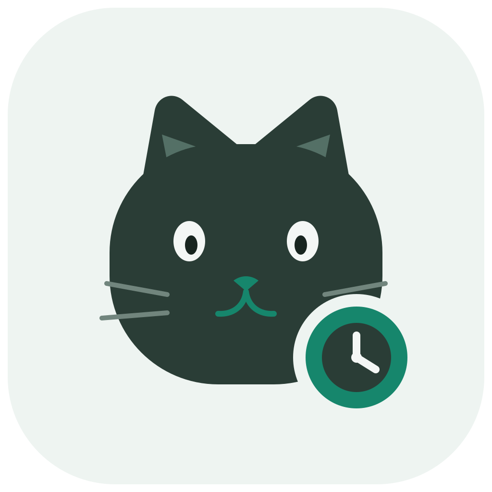

# ShiftPaw · 班次喵

<p align="center">
  
</p>

<p align="center"><strong>一只会巡游的桌面排班提醒猫</strong></p>

ShiftPaw 是一个原生 macOS 排班提醒与桌面宠物应用。它支持白班、夜班和跨日交接班次，小猫会在桌面可见区域内巡游，并在每经过一小时后卖萌一次。

## 功能

- 白班、夜班和跨日交接模板，支持编辑班次时间。
- 当前时间、值守状态、下一提醒和倒计时集中显示。
- 透明桌面小猫可自动巡游、手动拖动和隐藏。
- 每小时一次卖萌动画，双击桌宠可打开班次面板。
- 无声音系统通知、菜单栏驻留、始终置顶和登录时启动。
- 久坐定时提醒：猫咪气泡、面板倒计时、静音通知与稍后提醒。
- 自动恢复主窗口和桌宠位置，并校验持久化设置。
- 自动检查 GitHub 新版本，下载并校验更新安装包。

## 久坐提醒

默认开启，每 60 分钟提醒一次。在设置中可关闭提醒，或将间隔调整为 15 至 180 分钟。到时桌宠会显示“起来活动一下喵！”，面板会保留提醒，并尝试发送静音系统通知。通知未授权时，应用内提示仍可使用。

活动后，在面板、桌宠右键菜单或菜单栏点击“已活动，重新计时”，开始完整的新一轮计时；也可选择“10 分钟后提醒”。每轮只发送一次通知，等待确认或稍后提醒，避免重复打扰。

这是应用运行期间的定时提醒，不检测坐姿，也不依赖班次状态。启动应用、修改提醒设置，或每秒调度暂停超过 30 秒（例如电脑休眠）后，会重新开始计时。旧设置会保留班次和窗口配置，新增提醒使用默认值。

## 系统要求

- macOS 14 Sonoma 或更高版本
- 从源码构建需要 Swift 6 和匹配版本的 Xcode/macOS SDK

## 检查和安装更新

默认在启动时和每 6 小时检查一次本仓库的最新正式 Release，可在设置中关闭“自动检查更新”。也可从设置页或菜单栏手动“检查更新”。GitHub 匿名 API 限流时会改用官方 Release 页面与随包发布的 `SHA256SUMS.txt`，无需令牌。网络异常会显示失败原因，恢复连接后可重试。

发现新版本后，点击“下载更新”。应用只接受本仓库对应版本的 Apple Silicon DMG，并核对 GitHub 提供的 SHA-256；通过后才显示“打开安装包”。打开后，先退出 ShiftPaw，将新版拖入 Applications 替换，再重新打开。设置会保留。这一流程需要用户完成替换，不会在后台自动安装。

## 安装与登录时启动

将应用复制到 `/Applications/ShiftPaw.app`，再打开应用，在设置中开启“登录时启动”并保存。可在 macOS“系统设置 → 通用 → 登录项与扩展”确认 ShiftPaw 的状态；若系统要求批准，需在那里允许。移动应用位置后，应重新开启登录项。

本地临时签名构建没有 Apple 公证。如果从本仓库下载、确认来源可信的应用被首次打开检查拦截，可按 [Apple 的说明](https://support.apple.com/en-us/102445) 在“隐私与安全性”中选择“仍要打开”。也可在终端仅移除 ShiftPaw 的下载隔离属性：

```bash
xattr -dr com.apple.quarantine "/Applications/ShiftPaw.app"
open "/Applications/ShiftPaw.app"
```

`xattr` 不会修复损坏的应用或完成公证；若签名校验失败，应重新下载或重新构建。提示 `No such xattr` 表示相应文件没有该隔离属性。系统通知需另外在“系统设置 → 通知”中允许 ShiftPaw。

## 从源码运行

```bash
git clone https://github.com/nullinject/ShiftPaw.git
cd ShiftPaw
swift test
swift run ShiftPaw
```

如果使用 Homebrew Swift 6.3.3，其附带的 Testing 库要求 macOS 15。可仅为测试覆盖目标版本（应用仍以 macOS 14 为最低目标），并指定对应 SDK：

```bash
/opt/homebrew/opt/swift/bin/swift test \
  --sdk /Library/Developer/CommandLineTools/SDKs/MacOSX26.2.sdk \
  -Xswiftc -target -Xswiftc arm64-apple-macosx15.0
```

## 构建 macOS 应用

```bash
./scripts/build-app.sh
open ".build/app/ShiftPaw.app"
```

脚本默认执行本地临时签名。发布构建应通过环境变量传入 Developer ID Application 证书：

```bash
CODESIGN_IDENTITY="Developer ID Application: Example Corp (TEAMID)" \
APP_VERSION="1.1.0" BUILD_NUMBER="2" ./scripts/build-app.sh
```

正式分发还需要完成 Apple 公证与 stapling。签名证书、公证凭据和生成的应用包不应提交到仓库。

## 本地数据

设置保存在：

```text
~/Library/Application Support/ShiftPaw/settings.json
```

排班与久坐提醒可离线运行。自动检查更新会连接 GitHub 并发送应用版本号；下载更新也需要联网。班次、窗口设置与本地提醒记录不会上传。可关闭自动检查更新。

## 参与贡献

参见 [CONTRIBUTING.md](CONTRIBUTING.md)。安全问题请遵循 [SECURITY.md](SECURITY.md) 中的报告方式。

## 许可证

[MIT License](LICENSE)
